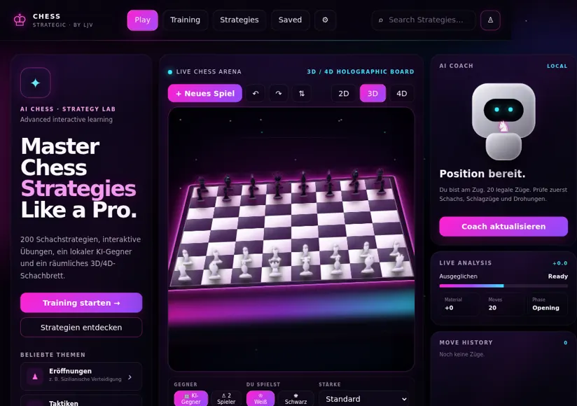

# Chess Strategic

Schachzüge ausprobieren, Stellungen erkunden und Strategien nachschlagen.

[App öffnen](https://larajacqueline-volkmer.github.io/studio-apps/chess-strategic/) · [Portfolio](../)

## Bedienung

Im Zweispielermodus einen Bauern ziehen und den Zug zurücknehmen.

## Herkunft

Mockup Board Final V2 mit Schachbrett, Zuglogik und Strategiebibliothek.

## Lokal ausführen

Den Ordner mit einem statischen HTTP-Server bereitstellen, etwa mit `python -m http.server 8000`. Nach dem ersten vollständigen Laden speichert der Service Worker die App für den Offline-Start.
