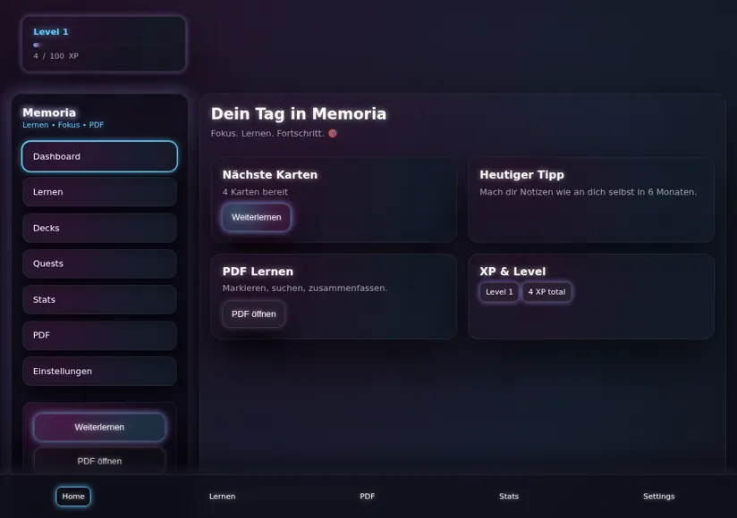

# Memoria

Lernkarten in Decks organisieren, Antworten aufdecken und den Lernfortschritt mit XP verfolgen.

[App öffnen](https://larajacqueline-volkmer.github.io/studio-apps/memoria/) · [Portfolio](../)

## Bedienung

Demo-Deck öffnen, eine Session starten, Antwort zeigen und bewerten.

## Herkunft

PWA Core Full, PWA Plus Full und die Icons aus dem separaten Memoria-Assetpaket.

## Lokal ausführen

Den Ordner mit einem statischen HTTP-Server bereitstellen, etwa mit `python -m http.server 8000`. Nach dem ersten vollständigen Laden speichert der Service Worker die App für den Offline-Start.
