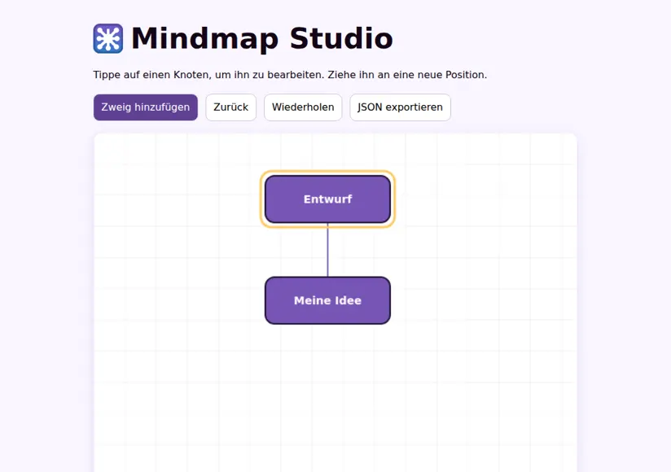

# Mindmap Studio

Gedanken als verbundene Knoten zeichnen und die Karte lokal weiterschreiben.

[App öffnen](https://larajacqueline-volkmer.github.io/studio-apps/mindmap/) · [Portfolio](../)

## Bedienung

Zweig hinzufügen, umbenennen, neu laden und die Bearbeitung fortsetzen.

## Herkunft

Canvas-Editor aus Mindmap Cloud Pro LocalAccounts mit Stil und Icons aus Mindmap Cloud Pro.

## Lokal ausführen

Den Ordner mit einem statischen HTTP-Server bereitstellen, etwa mit `python -m http.server 8000`. Nach dem ersten vollständigen Laden speichert der Service Worker die App für den Offline-Start.
