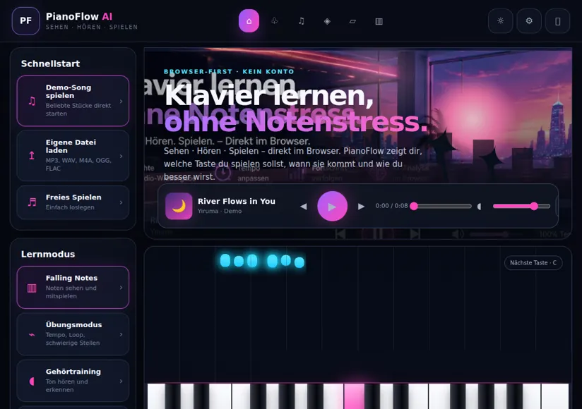

# PianoFlow AI

Am Touch-Piano spielen und Melodien mit regelbarem Tempo üben.

[App öffnen](https://larajacqueline-volkmer.github.io/studio-apps/pianoflow/) · [Portfolio](../)

## Bedienung

Demo abspielen und pausieren.

## Herkunft

PianoFlow AI Functional GitHub Final mit bestehender Oberfläche und Audio-Engine.

## Lokal ausführen

Den Ordner mit einem statischen HTTP-Server bereitstellen, etwa mit `python -m http.server 8000`. Nach dem ersten vollständigen Laden speichert der Service Worker die App für den Offline-Start.
