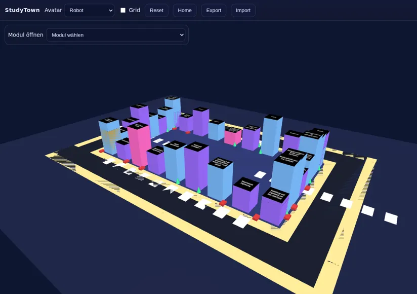

# StudyTown 3D

[App öffnen](https://larajacqueline-volkmer.github.io/studio-apps/studytown3d/) · [Portfolio](../)

Die vorhandene StudyTown3D-v2-Quelle wurde als eigenständige PWA aufbereitet. Kamera-Initialisierung und inkompatible Bibliothekslinks wurden repariert. Three.js und OrbitControls liegen lokal einschließlich Lizenz vor.

Wähle ein Modul über die Auswahlliste oder ein Gebäude. Speichere Status, Notizen, Checklisten und Ressourcen im Modulfenster. Export und Import dienen als lokale Datensicherung. Ziehen und Pinch bedienen die Kamera. Auf der Tastatur steuern die Pfeile den Avatar.

Die enthaltenen Modulnamen stammen aus der älteren Projektquelle. Neue Browser beginnen ohne bestätigte Fortschritte. Der aktuelle persönliche Studienstand muss lokal eingetragen werden. Die Modulnamen sind keine verbindliche aktuelle Prüfungsordnung.

Die winzigen Avatar-Platzhalter wurden durch einfache selbst erstellte Gesichtssymbole ersetzt. Das Spiel benötigt WebGL. Lokale Daten bleiben auf diesem Gerät.

Lokal starten mit einem statischen HTTP-Server, etwa python -m http.server 8000.
