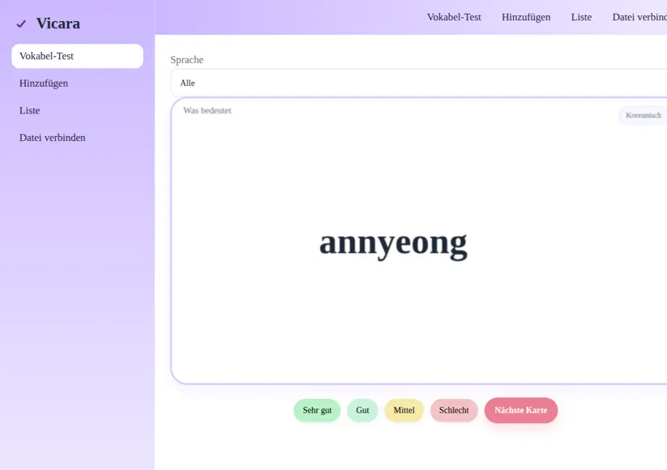

# Vicara

Eigene Vokabeln erfassen und mit wendbaren Lernkarten üben.

[App öffnen](https://larajacqueline-volkmer.github.io/studio-apps/vocara/) · [Portfolio](../)

## Bedienung

Eine eigene Vokabel anlegen und eine Lernkarte umdrehen.

## Herkunft

Vicara Project aus der Vocara-Sicherung mit Karten, Eingabe, Liste und Dateiwerkzeugen.

## Lokal ausführen

Den Ordner mit einem statischen HTTP-Server bereitstellen, etwa mit `python -m http.server 8000`. Nach dem ersten vollständigen Laden speichert der Service Worker die App für den Offline-Start.
